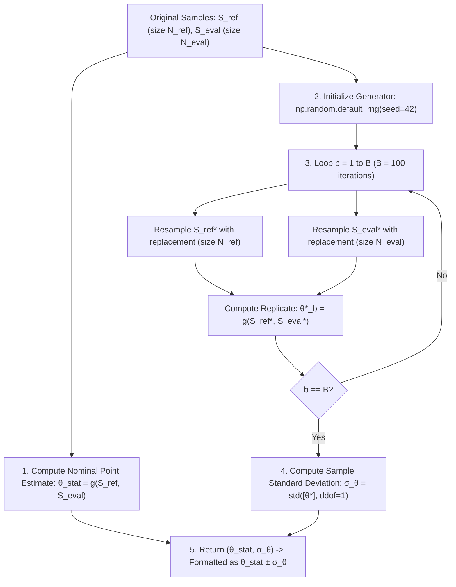

# Curve Comparisons and Uncertainty Quantification in Validation Pipelines

This document provides a comprehensive mathematical and algorithmic reference for the curve comparison routines, statistical distance metrics, and uncertainty estimation methods implemented across [`notebooks/single_region_full_validation.ipynb`](file:///home/pmourafr/egamma_master/notebooks/single_region_full_validation.ipynb) and the validation engine.

---

## 1. Feature Distribution and Selection Ratio Curves

Feature distributions assess how model selections reshape observable calorimeter quantities compared to true physics populations (photons as signal, jets as background). The two-panel visualization is implemented in [`FeatureDistributionPlotter`](file:///home/pmourafr/egamma_master/src/core/Plotting/FeatureDistributionPlotter.py).

### 1.1 Upper Panel: Binned Event Yields

Given a continuous shower-shape or kinematic observable $x$ (e.g. $E_{\text{ratio}}$, $R_{\eta}$, $w_{\text{stot}}$):

1. The observable space is partitioned into $K$ equal-width bins $[b_{k}, b_{k+1})$ covering the bulk distribution (empirically bounded by the 0.5% and 99.5% percentiles).
2. The number of events falling into bin $k$ is tabulated for:
   - **Ground Truth**: $N_{\text{true}, k} = \sum_{i=1}^{N} \mathbb{I}(x_i \in [b_k, b_{k+1}) \land y_i = c)$
   - **Strategy Selection**: $N_{\text{sel}, k} = \sum_{i=1}^{N} \mathbb{I}(x_i \in [b_k, b_{k+1}) \land y_i = c \land \hat{y}_i = 1)$
   where $c \in \{0, 1\}$ represents the class (signal or background) and $\hat{y}_i \in \{0, 1\}$ denotes the decision from an ML model or benchmark cut.

#### Uncertainty Formulation: Poisson Counting Statistics

Because event arrivals in particle collisions are governed by a Poisson process, the variance of an observed count $N_k$ equals its expectation value $\mathbb{E}[N_k] \approx N_k$:

$$\sigma_{N_{\text{sel}, k}} = \sqrt{N_{\text{sel}, k}}, \qquad \sigma_{N_{\text{true}, k}} = \sqrt{N_{\text{true}, k}}$$

In the upper panel:

- Ground-truth data points are rendered as solid black markers without error bars to serve as the absolute physical reference.
- ML models and Athena linear cuts are rendered with Poisson error bars $\pm \sigma_{N_{\text{sel}, k}}$.

---

### 1.2 Lower Panel: Selection Ratio ($N_{\text{sel}} / N_{\text{true}}$)

The lower sub-panel monitors the fraction of true events accepted by a selection algorithm as a function of the observable $x$:

$$R_k = \frac{N_{\text{sel}, k}}{N_{\text{true}, k}}$$

For signal events ($y_i = 1$), $R_k$ reflects the local detection efficiency $\text{PD}(x)$. For background events ($y_i = 0$), $R_k$ reflects the local fake rate $\text{PF}(x)$. A flat ratio across bins indicates shape preservation without observable distortion.

#### Ratio Uncertainty Derivation

Using first-order error propagation for the quotient $R = A / B$ where $A = N_{\text{sel}, k}$ and $B = N_{\text{true}, k}$:

$$\frac{\sigma_R^2}{R^2} = \left(\frac{\sigma_A}{A}\right)^2 + \left(\frac{\sigma_B}{B}\right)^2 - 2 \frac{\text{Cov}(A, B)}{A \cdot B}$$

Under the conservative approximation of independent counting fluctuations between the selected subset and the total sample:

$$\frac{\sigma_R}{R} = \sqrt{\left(\frac{\sigma_{N_{\text{sel}, k}}}{N_{\text{sel}, k}}\right)^2 + \left(\frac{\sigma_{N_{\text{true}, k}}}{N_{\text{true}, k}}\right)^2}$$

Substituting the Poisson errors $\sigma_{N_{\text{sel}, k}} = \sqrt{N_{\text{sel}, k}}$ and $\sigma_{N_{\text{true}, k}} = \sqrt{N_{\text{true}, k}}$:

$$\sigma_{R_k} = R_k \sqrt{\frac{1}{N_{\text{sel}, k}} + \frac{1}{N_{\text{true}, k}}}$$

When $N_{\text{true}, k} = 0$, the ratio and its uncertainty are assigned `np.nan`.

---

## 2. Statistical Distance Metrics and Divergences

To quantitatively score how well an algorithm's selection matches a reference distribution (ground truth, Athena trigger cut, or a baseline ML model), [`DistributionComparator`](file:///home/pmourafr/egamma_master/src/core/Validation/DistributionComparator.py) and [`src/utils.py`](file:///home/pmourafr/egamma_master/src/utils.py) calculate four complementary statistical distances.

### 2.1 Kolmogorov-Smirnov Test ($D$)

The two-sample Kolmogorov-Smirnov statistic evaluates the maximum vertical discrepancy between the empirical cumulative distribution functions (eCDFs) of the reference sample $S_{\text{ref}}$ and evaluated selection $S_{\text{eval}}$:

$$D = \sup_{x} \left| F_{\text{ref}}(x) - F_{\text{eval}}(x) \right|$$

where:

$$F(x) = \frac{1}{n} \sum_{i=1}^n \mathbb{I}(x_i \le x)$$

- **Domain**: $D \in [0, 1]$, where $D = 0$ indicates identical distributions.
- **Statistical Significance**: The asymptotic two-sided $p$-value is evaluated via `scipy.stats.ks_2samp(sample_ref, sample_eval)` under the null hypothesis $H_0: F_{\text{ref}} = F_{\text{eval}}$.

### 2.2 First Wasserstein Distance ($W_1$)

Also known as the Earth Mover's Distance, $W_1$ measures the minimum work required to transform one probability distribution into another:

$$W_1(u, v) = \int_{-\infty}^{\infty} \left| U(x) - V(x) \right| \, dx$$

where $U(x)$ and $V(x)$ are the cumulative distributions of $S_{\text{ref}}$ and $S_{\text{eval}}$.

- **Units**: Retains the physical units of the measured observable (e.g. MeV for transverse energy, dimensionless for shower shapes).
- Computed via `scipy.stats.wasserstein_distance`.

### 2.3 Empirical Probability Mass Estimation with Regularization

For discrete information-theoretic measures ($D_{\text{KL}}$ and $D_{\text{JS}}$), continuous samples are discretized into $K = 35$ bins spanning the common empirical range $[\min(S_{0.5\%}), \max(S_{99.5\%})]$. To avoid numerical singularities $(\ln 0)$ when a bin contains zero counts, Laplace/epsilon smoothing ($\epsilon = 10^{-7}$) is applied:

$$p_k = \frac{c_{\text{ref}, k} + \epsilon}{\sum_{j=1}^K c_{\text{ref}, j} + \epsilon \cdot K}, \qquad q_k = \frac{c_{\text{eval}, k} + \epsilon}{\sum_{j=1}^K c_{\text{eval}, j} + \epsilon \cdot K}$$

This ensures valid probability vectors: $\sum_{k=1}^K p_k = 1$ and $\sum_{k=1}^K q_k = 1$ with $p_k, q_k > 0$.

### 2.4 Kullback-Leibler Divergence ($D_{\text{KL}}$)

The relative entropy measuring information loss when $Q$ (evaluated model) approximates $P$ (reference):

$$D_{\text{KL}}(P \parallel Q) = \sum_{k=1}^K p_k \ln\left(\frac{p_k}{q_k}\right)$$

- **Domain**: $D_{\text{KL}} \ge 0$, with $D_{\text{KL}} = 0$ if and only if $P = Q$ almost everywhere.
- **Asymmetry**: $D_{\text{KL}}(P \parallel Q) \ne D_{\text{KL}}(Q \parallel P)$.

### 2.5 Jensen-Shannon Divergence ($D_{\text{JS}}$)

A symmetric, smoothed, and bounded version of the KL divergence. Let $M = \frac{1}{2}(P + Q)$ be the mixture distribution:

$$D_{\text{JS}}(P \parallel Q) = \frac{1}{2 \ln 2} D_{\text{KL}}(P \parallel M) + \frac{1}{2 \ln 2} D_{\text{KL}}(Q \parallel M)$$

- **Normalization**: Dividing by $\ln 2$ bounds the metric strictly in $[0, 1]$.
- **Symmetry**: $D_{\text{JS}}(P \parallel Q) = D_{\text{JS}}(Q \parallel P)$.

---

## 3. Bootstrap Methodology for Distance Metrics and Divergences

### 3.1 The Fundamental Problem of Point Estimation & Uncertainty

In experimental physics and machine learning validation, an experimenter seeks to infer an unknown property of nature or an algorithm. Suppose we wish to measure the degree of divergence or distance $\theta$ between two physical distributions:
- $F_X$: The true distribution of electromagnetic shower shapes produced by photons (Signal).
- $F_Y$: The distribution of shower shapes accepted by a machine learning selection algorithm.

From our detector holdout partition, we observe a finite sample:
- A reference sample $X = \{x_1, x_2, \dots, x_n\} \sim F_X$
- An evaluated sample $Y = \{y_1, y_2, \dots, y_m\} \sim F_Y$

To quantify how closely $Y$ resembles $X$, we apply a statistical distance function $g$ (such as Kolmogorov-Smirnov $D$, Wasserstein $W_1$, or Kullback-Leibler $D_{\text{KL}}$):

$$\hat{\theta}_{\text{stat}} = g(X, Y)$$

We designate $\hat{\theta}_{\text{stat}}$ as the **point estimate** (or nominal measurement). It is our single best evaluation of the true distance parameter $\theta$.

However, in empirical science, a point estimate alone is incomplete without a measure of its statistical precision. If an identical experiment were conducted at another collider under identical conditions, quantum and thermal fluctuations would yield a slightly different dataset $X^{(2)}$ and $Y^{(2)}$. Consequently, their estimate $\hat{\theta}^{(2)} = g(X^{(2)}, Y^{(2)})$ would differ from $\hat{\theta}_{\text{stat}}$.

If this experiment could be repeated $M$ times, the resulting sequence of estimates $\{\hat{\theta}^{(1)}, \hat{\theta}^{(2)}, \dots, \hat{\theta}^{(M)}\}$ would form a probability distribution known as the **sampling distribution** of the estimator. The standard deviation of this distribution is the **standard error** $\sigma_{\hat{\theta}}$, which defines the measurement error bar:

$$\text{Reported Result} = \hat{\theta}_{\text{stat}} \pm \sigma_{\hat{\theta}}$$

### 3.2 The Impasse & The Bootstrap Principle (Efron, 1979)

In practice:

1. **We cannot repeat the experiment $M$ times.** We possess only the single holdout dataset $(X, Y)$ recorded by the detector.
2. For simple linear statistics (such as the arithmetic mean $\bar{x}$), the Central Limit Theorem provides an analytical formula: $\sigma_{\bar{x}} = s / \sqrt{n}$.
3. For non-linear, multi-sample distance metrics like the Kolmogorov-Smirnov supremum $D = \sup_t |F_n(t) - F_m(t)|$ or relative entropy $D_{\text{KL}}$, **no universal, closed-form analytical variance formula exists**.

To solve this, the **Bootstrap Principle** (Efron, 1979) introduces the *plug-in rule*:
Because the true underlying population distribution $F_X$ is unknown, our best non-parametric approximation of $F_X$ is the **empirical distribution** $\hat{F}_n$, which assigns equal probability $1/n$ to each observed data point. Therefore, drawing a new sample from nature can be simulated with high fidelity by **drawing from our existing dataset with replacement**.

---

### 3.3 Formal Distinction: $\hat{\theta}_{\text{stat}}$ versus $\hat{\theta}_b^*$

The methodology separates the measurement of the value from the measurement of its uncertainty:

#### 1. The Nominal Statistic $\hat{\theta}_{\text{stat}}$ (Real Measurement)

$$\hat{\theta}_{\text{stat}} = g(X, Y)$$
- **Data Source**: Evaluated strictly on the genuine, unmodified experimental dataset.
- **Frequency**: Evaluated exactly **once**.
- **Role**: Determines **WHERE** the measurement lies (the central point estimate reported in tables).

#### 2. The Bootstrap Replicates $\hat{\theta}_b^*$ (Simulated Fluctuations)

For each replication $b \in \{1, 2, \dots, B\}$ (default $B = 100$):

1. Draw a pseudo-reference sample $X^{*b}$ of size $n$ from $X$ **with replacement**.
2. Draw a pseudo-evaluated sample $Y^{*b}$ of size $m$ from $Y$ **with replacement**.
3. Compute the replicate metric:
   $$\hat{\theta}_b^* = g\left(X^{*b}, Y^{*b}\right)$$

* **Data Source**: Evaluated on synthetic resamples.
- **Frequency**: Evaluated **$B = 100$ times**, yielding an ensemble $\{\hat{\theta}_1^*, \hat{\theta}_2^*, \dots, \hat{\theta}_B^*\}$.
- **Role**: Determines **HOW PRECISE** the measurement is. The replicates are never reported individually; their sample dispersion maps out the estimator's variance.

---

### 3.4 Concrete Pedagogical Walkthrough

To see how this works mechanically, consider an observable with a minimal sample:
- True reference events: $X = \{1.2, \; 2.4, \; 3.8\}$ ($n = 3$)
- Model-selected events: $Y = \{1.5, \; 2.8, \; 4.1\}$ ($m = 3$)

#### Step 1: Compute Nominal Measurement $\hat{\theta}_{\text{stat}}$

We evaluate the chosen distance metric $g$ once on $(X, Y)$:

$$\hat{\theta}_{\text{stat}} = g(\{1.2, 2.4, 3.8\}, \; \{1.5, 2.8, 4.1\}) = \mathbf{0.30}$$

This is our central measured result.

#### Step 2: Generate the Bootstrap Ensemble $\{\hat{\theta}_b^*\}$

We now simulate experimental fluctuations by drawing with replacement:
- **Iteration $b = 1$:**
  - Sample $X^{*1} = \{1.2, \; 1.2, \; 3.8\}$ (event $1.2$ drawn twice; $2.4$ omitted)
  - Sample $Y^{*1} = \{1.5, \; 4.1, \; 4.1\}$
  - Compute: $\hat{\theta}_1^* = g(X^{*1}, Y^{*1}) = \mathbf{0.34}$
- **Iteration $b = 2$:**
  - Sample $X^{*2} = \{2.4, \; 2.4, \; 3.8\}$
  - Sample $Y^{*2} = \{1.5, \; 2.8, \; 2.8\}$
  - Compute: $\hat{\theta}_2^* = g(X^{*2}, Y^{*2}) = \mathbf{0.27}$
- **Iteration $b = 3$:**
  - Sample $X^{*3} = \{1.2, \; 3.8, \; 3.8\}$
  - Sample $Y^{*3} = \{2.8, \; 4.1, \; 4.1\}$
  - Compute: $\hat{\theta}_3^* = g(X^{*3}, Y^{*3}) = \mathbf{0.31}$

This is repeated for $B = 100$ iterations, creating the numerical array:

$$\{\hat{\theta}_1^*, \; \hat{\theta}_2^*, \; \dots, \; \hat{\theta}_{100}^*\} = \{0.34, \; 0.27, \; 0.31, \; \dots\}$$

#### Step 3: Compute Standard Error

We compute the sample standard deviation of the $B$ replicates with Bessel correction (`ddof=1`):

$$\sigma_{\hat{\theta}} = \sqrt{\frac{1}{B - 1} \sum_{b=1}^{B} \left(\hat{\theta}_b^* - \bar{\theta}^*\right)^2}, \qquad \text{where } \bar{\theta}^* = \frac{1}{B}\sum_{b=1}^B \hat{\theta}_b^*$$

If the standard deviation of our 100 values is $0.03$, the final reported result is:

$$\theta = \hat{\theta}_{\text{stat}} \pm \sigma_{\hat{\theta}} = \mathbf{0.30 \pm 0.03}$$

---

### 3.5 Algorithmic Implementation in `src/utils.py`

This protocol is implemented in:

- [`compute_ks_test_with_uncertainty()`](file:///home/pmourafr/egamma_master/src/utils.py#L432-L468)
- [`compute_wasserstein_with_uncertainty()`](file:///home/pmourafr/egamma_master/src/utils.py#L470-L504)
- [`compute_kl_divergence_with_uncertainty()`](file:///home/pmourafr/egamma_master/src/utils.py#L534-L586)
- [`compute_js_divergence_with_uncertainty()`](file:///home/pmourafr/egamma_master/src/utils.py#L588-L643)



### 3.6 The Crucial Detail for KL and JS Divergences: Coordinate Grid Pinning

While the Kolmogorov-Smirnov test and Wasserstein distance operate directly on continuous, sorted 1D arrays without discretization, the information-theoretic divergences ($D_{\text{KL}}$ and $D_{\text{JS}}$) require probability vectors $P = [p_1, \dots, p_K]$ and $Q = [q_1, \dots, q_K]$:

$$D_{\text{KL}}(P \parallel Q) = \sum_{k=1}^K p_k \ln\left(\frac{p_k}{q_k}\right)$$

To evaluate these on continuous calorimeter observables, events must be discretized into a histogram with $K = 35$ bins.

#### 1. The Danger: What Happens WITHOUT Grid Pinning?

When performing bootstrap draws with replacement, extreme values or outliers are randomly included in some iterations and omitted in others. If the algorithm recomputed histogram bin edges dynamically inside each bootstrap iteration:

$$\text{Draw } b = 1: \quad [0.00 \;\text{---}\; 0.05 \;\text{---}\; 0.10 \;\text{---}\; \dots]$$

$$\text{Draw } b = 2: \quad [0.03 \;\text{---}\; 0.07 \;\text{---}\; 0.11 \;\text{---}\; \dots]$$

$$\text{Draw } b = 3: \quad [-0.02 \;\text{---}\; 0.04 \;\text{---}\; 0.10 \;\text{---}\; \dots]$$

In such a naive scheme, bin $k=1$ represents interval $[0.00, 0.05)$ in draw 1, but shifts to $[0.03, 0.07)$ in draw 2.

Comparing $p_k$ and $q_k$ when the bins keep shifting is equivalent to **measuring distances with a ruler that shrinks, stretches, and shifts with every measurement**. The computed divergence fluctuates not because of physics or event statistics, but because the underlying coordinate system itself is jittering. This coordinate drift severely inflates the estimated bootstrap variance with artificial geometric noise.

#### 2. The Solution: Pinned Coordinate Grids in `src/utils.py`

To eliminate this artifact, the implementation in [`compute_kl_divergence_with_uncertainty()`](file:///home/pmourafr/egamma_master/src/utils.py#L563-L583) and [`compute_js_divergence_with_uncertainty()`](file:///home/pmourafr/egamma_master/src/utils.py#L619-L639) **pins** the coordinate grid before the bootstrap loop begins:

1. **Before the Loop Starts**: The algorithm scans the combined original dataset once to determine robust empirical bounds (the 0.5% and 99.5% percentiles, filtering pathological detector outliers). It partitions this fixed interval into $K = 35$ rigid bin edges:

   ```python
   fixed_bin_edges = np.linspace(low, high, bins + 1)
   ```

2. **Inside the Bootstrap Loop**: For every iteration $b \in \{1, \dots, B\}$, resampled events $S_{\text{ref}}^{*b}$ and $S_{\text{eval}}^{*b}$ are strictly binned using `fixed_bin_edges`.
3. **Physical Invariance**: Bin $k$ represents the exact same physical interval across all $B = 100$ draws. The only quantities that fluctuate are the **event counts** inside each bin, which accurately isolates real statistical Poisson-like counting fluctuations.

#### 3. Partner Safeguard: Laplace / Epsilon Smoothing ($\epsilon = 10^{-7}$)

Even with a fixed coordinate grid, a bootstrap draw may occasionally yield zero counts ($c_k = 0$) in an unpopulated bin. Since $q_k = 0$ in the denominator produces a division-by-zero or $\ln(0)$ singularity, the code applies **Laplace / epsilon regularization**:

$$p_k = \frac{c_{\text{ref}, k} + \epsilon}{\sum_{j=1}^K c_{\text{ref}, j} + \epsilon \cdot K}, \qquad q_k = \frac{c_{\text{eval}, k} + \epsilon}{\sum_{j=1}^K c_{\text{eval}, j} + \epsilon \cdot K}$$

With $\epsilon = 10^{-7}$:
- Every bin is guaranteed a non-zero probability mass, ensuring absolute numerical stability.
- Because $\epsilon \ll 1$, it does not distort the true physical distribution while completely preventing runtime `NaN` or `Inf` failures.

#### Grid Pinning Summary

| Feature | Without Grid Pinning (Flawed) | With Grid Pinning (Our Implementation) |
| --- | --- | --- |
| **Bin Edges** | Recalculated dynamically on each bootstrap draw | Frozen from original data before the loop begins |
| **Coordinate System** | Shifts and stretches on every iteration | Permanently pinned across all $B = 100$ iterations |
| **What Fluctuates** | Both coordinate boundaries and event counts | **Only** event counts inside identical physical bins |
| **Uncertainty ($\sigma$)** | Artificially inflated by coordinate jitter | Purely reflects statistical event fluctuations |

---

## 4. Kinematic Detection Efficiency Curves

[`EfficiencyPlotter`](file:///home/pmourafr/egamma_master/src/core/Validation/EfficiencyPlotter.py) evaluates signal detection efficiency as a continuous function of kinematic properties, specifically transverse energy ($E_T$) and pseudorapidity ($\eta$).

### 4.1 Binned Efficiency Estimation

Given true signal events ($y_i = 1$) partitioned into $M$ bins along kinematic feature $X$:

1. $N_m = \sum_{i=1}^N \mathbb{I}(X_i \in [b_m, b_{m+1}) \land y_i = 1)$ is the total signal count in bin $m$.
2. $k_m = \sum_{i=1}^N \mathbb{I}(X_i \in [b_m, b_{m+1}) \land y_i = 1 \land \hat{y}_i = 1)$ is the number of accepted signal events.
3. The empirical efficiency is:

$$\epsilon_m = \frac{k_m}{N_m}$$

### 4.2 Binomial Uncertainty

Since each signal event represents a Bernoulli trial with probability of detection $\epsilon_m$, the number of accepted events $k_m$ follows a binomial distribution $\text{Binomial}(N_m, \epsilon_m)$. The standard error on the efficiency estimator $\epsilon_m$ is:

$$\sigma_{\epsilon_m} = \sqrt{\frac{\epsilon_m (1 - \epsilon_m)}{N_m}}$$

The curve is plotted with vertical error bars $\pm \sigma_{\epsilon_m}$ centered at bin midpoints $\bar{X}_m = \frac{1}{2}(b_m + b_{m+1})$.

---

## 5. Operational Working Points & SP Metric Uncertainty

Operating points and classification performance metrics are encapsulated within [`StrategyMetrics`](file:///home/pmourafr/egamma_master/src/core/Validation/QuadrantAnalyzer.py#L31-L139).

### 5.1 Confusion Matrix Quantities

From binary predictions $\hat{y}$ and labels $y \in \{0, 1\}$:

- **True Positives**: $\text{TP} = \sum \mathbb{I}(\hat{y}=1 \land y=1)$
- **False Negatives**: $\text{FN} = \sum \mathbb{I}(\hat{y}=0 \land y=1)$
- **True Negatives**: $\text{TN} = \sum \mathbb{I}(\hat{y}=0 \land y=0)$
- **False Positives**: $\text{FP} = \sum \mathbb{I}(\hat{y}=1 \land y=0)$
- **Total Signal**: $N_{\text{sig}} = \text{TP} + \text{FN}$
- **Total Background**: $N_{\text{bg}} = \text{TN} + \text{FP}$
- **Total Events**: $N_{\text{total}} = N_{\text{sig}} + N_{\text{bg}}$

### 5.2 Binomial Uncertainties on Rates

Each rate represents an empirical proportion whose uncertainty is given by the standard error of a binomial proportion:

| Metric | Formula | Uncertainty ($\sigma$) |
| --- | --- | --- |
| **Probability of Detection (PD / TPR)** | $\text{PD} = \frac{\text{TP}}{N_{\text{sig}}}$ | $\sigma_{\text{PD}} = \sqrt{\frac{\text{PD}(1 - \text{PD})}{N_{\text{sig}}}}$ |
| **Probability of False Alarm (PF / FPR)** | $\text{PF} = \frac{\text{FP}}{N_{\text{bg}}}$ | $\sigma_{\text{PF}} = \sqrt{\frac{\text{PF}(1 - \text{PF})}{N_{\text{bg}}}}$ |
| **Background Rejection ($1 - \text{PF}$)** | $1 - \text{PF} = \frac{\text{TN}}{N_{\text{bg}}}$ | $\sigma_{1 - \text{PF}} = \sqrt{\frac{\text{PF}(1 - \text{PF})}{N_{\text{bg}}}}$ |
| **Accuracy (Efficiency)** | $\text{Eff} = \frac{\text{TP} + \text{TN}}{N_{\text{total}}}$ | $\sigma_{\text{Eff}} = \sqrt{\frac{\text{Eff}(1 - \text{Eff})}{N_{\text{total}}}}$ |

---

### 5.3 Mathematical Derivation: ATLAS SP Metric Uncertainty

The ATLAS standard SP (Significance Performance) index balances signal detection against background rejection using the geometric-arithmetic mean product:

$$\text{SP} = \sqrt{\sqrt{u \cdot v} \cdot \left(\frac{u + v}{2}\right)}$$

where:

- $u = \text{PD} \in [0, 1]$ (signal efficiency)
- $v = 1 - \text{PF} \in [0, 1]$ (background rejection)

#### Step 1: Logarithmic Transformation

Taking the natural logarithm simplifies differentiation:

$$\ln(\text{SP}) = \frac{1}{2} \left[ \frac{1}{2} (\ln u + \ln v) + \ln(u + v) - \ln 2 \right]$$

$$\ln(\text{SP}) = \frac{1}{4} \ln u + \frac{1}{4} \ln v + \frac{1}{2} \ln(u + v) - \frac{1}{2} \ln 2$$

#### Step 2: Partial Derivatives

Differentiating $\ln(\text{SP})$ with respect to $u$ and $v$:

$$\frac{\partial \ln(\text{SP})}{\partial u} = \frac{1}{\text{SP}} \frac{\partial \text{SP}}{\partial u} = \frac{1}{4u} + \frac{1}{2(u + v)}$$

$$\frac{\partial \ln(\text{SP})}{\partial v} = \frac{1}{\text{SP}} \frac{\partial \text{SP}}{\partial v} = \frac{1}{4v} + \frac{1}{2(u + v)}$$

Let:

$$T_u = \frac{1}{4u} + \frac{1}{2(u + v)}, \qquad T_v = \frac{1}{4v} + \frac{1}{2(u + v)}$$

#### Step 3: Variance Propagation under Independent Partitions

Because $u = \text{PD}$ is measured exclusively on the signal partition ($N_{\text{sig}}$) and $v = 1 - \text{PF}$ is measured exclusively on the background partition ($N_{\text{bg}}$), the two estimators are statistically independent:

$$\text{Cov}(u, v) = 0$$

Their binomial sampling variances are:

$$\sigma_u^2 = \frac{u(1 - u)}{N_{\text{sig}}}, \qquad \sigma_v^2 = \frac{v(1 - v)}{N_{\text{bg}}} = \frac{\text{PF}(1 - \text{PF})}{N_{\text{bg}}}$$

Applying first-order Taylor expansion:

$$\frac{\sigma_{\text{SP}}^2}{\text{SP}^2} = T_u^2 \sigma_u^2 + T_v^2 \sigma_v^2$$

Multiplying by $\text{SP}^2$:

$$\sigma_{\text{SP}} = \text{SP} \cdot \sqrt{\left(\frac{1}{4u} + \frac{1}{2(u + v)}\right)^2 \frac{u(1 - u)}{N_{\text{sig}}} + \left(\frac{1}{4v} + \frac{1}{2(u + v)}\right)^2 \frac{v(1 - v)}{N_{\text{bg}}}}$$

This closed-form formulation delivers the exact analytical standard error computed by [`StrategyMetrics.sp_uncertainty`](file:///home/pmourafr/egamma_master/src/core/Validation/QuadrantAnalyzer.py#L120-L139) without requiring approximation or Monte Carlo propagation.

---

## 6. Summary of Validation Routines and References

| Workflow / Output | Function / Class | Location | Uncertainty Type |
| --- | --- | --- | --- |
| **Feature Distributions & Selection Ratios** | `FeatureDistributionPlotter.plot_single_feature` | [`FeatureDistributionPlotter.py`](file:///home/pmourafr/egamma_master/src/core/Plotting/FeatureDistributionPlotter.py) | Poisson ($\sqrt{N}$) & Propagated Ratio Error |
| **Statistical Distance Metrics** | `DistributionComparator.compare_strategies` | [`DistributionComparator.py`](file:///home/pmourafr/egamma_master/src/core/Validation/DistributionComparator.py) | Non-parametric Bootstrap ($B=100$) |
| **Two-Sample KS Test** | `compute_ks_test_with_uncertainty` | [`src/utils.py`](file:///home/pmourafr/egamma_master/src/utils.py#L432) | Bootstrap Std Dev + Asymptotic $p$-value |
| **Wasserstein Distance** | `compute_wasserstein_with_uncertainty` | [`src/utils.py`](file:///home/pmourafr/egamma_master/src/utils.py#L470) | Bootstrap Std Dev |
| **KL & JS Divergences** | `compute_kl_divergence_with_uncertainty`, `compute_js_divergence_with_uncertainty` | [`src/utils.py`](file:///home/pmourafr/egamma_master/src/utils.py#L534) | Grid-Pinned Bootstrap Std Dev |
| **Kinematic Efficiency Curves** | `EfficiencyPlotter.plot_efficiency_vs_feature` | [`EfficiencyPlotter.py`](file:///home/pmourafr/egamma_master/src/core/Validation/EfficiencyPlotter.py) | Binomial ($\sqrt{\epsilon(1-\epsilon)/N}$) |
| **Operating Points ($PD$, $PF$, $Eff$)** | `StrategyMetrics.from_predictions` | [`QuadrantAnalyzer.py`](file:///home/pmourafr/egamma_master/src/core/Validation/QuadrantAnalyzer.py#L31) | Binomial Proportions |
| **ATLAS SP Index** | `StrategyMetrics.sp_uncertainty` | [`QuadrantAnalyzer.py`](file:///home/pmourafr/egamma_master/src/core/Validation/QuadrantAnalyzer.py#L120) | First-Order Partial Derivative Propagation |
