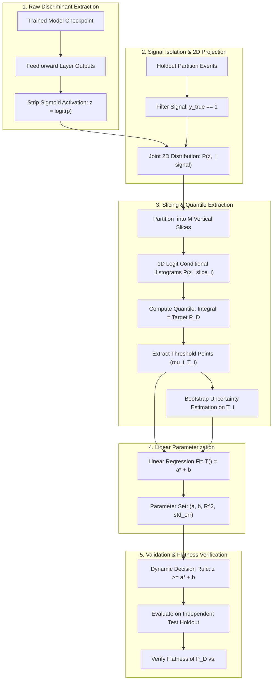

# Pileup Sensitivity Analysis and 2D Threshold Calibration Process Specification

This document provides a formal engineering and physical specification of the pileup sensitivity analysis and the two-dimensional dynamic threshold calibration ($T(\mu) = a\mu + b$) implemented in the `egamma_master` framework and executed interactively via [`notebooks/pileup_2d_threshold_calibration.ipynb`](file:///home/pmourafr/egamma_master/notebooks/pileup_2d_threshold_calibration.ipynb).

---

## 1. Physics Context & Invariant Efficiency Requirements

### 1.1 The Pileup Phenomenon in the LHC
In high-luminosity proton-proton collisions at the Large Hadron Collider (LHC), bunches of protons collide every 25 ns. In addition to the hard-scattering interaction of interest (e.g., prompt photon or electron production), multiple soft inelastic collisions occur simultaneously within the same bunch crossing (in-time pileup) and across adjacent crossings (out-of-time pileup). 

The instantaneous pileup activity is quantified by $\langle\mu\rangle$, the average number of inelastic proton-proton interactions per bunch crossing:

$$\langle\mu\rangle = \frac{\mathcal{L}_{\text{inst}} \cdot \sigma_{\text{inel}}}{f_{\text{rev}}}$$

where $\mathcal{L}_{\text{inst}}$ is the instantaneous luminosity, $\sigma_{\text{inel}} \approx 80\text{ mb}$ is the total inelastic cross section at $\sqrt{s} = 13\text{ TeV}$, and $f_{\text{rev}} \approx 11.245\text{ kHz}$ is the LHC revolution frequency.

### 1.2 Impact on Calorimeter Rings and Discriminants
In the ATLAS Liquid Argon (LAr) and Tile Calorimeters, pileup deposits diffuse low-energy particles throughout the calorimeter cells. When concentric calorimeter rings are extracted around the cluster centroid:
1. Outer calorimeter rings accumulate diffuse stochastic energy from pileup vertices.
2. The shower shape distributions widen, altering lateral and longitudinal containment variables ($R_{\eta}, R_{\phi}, w_{\text{stot}}$).
3. The neural network output $y_{\text{NN}}(\mathbf{x})$, trained to separate isolated prompt photons from hadronic jet fragments, experiences observable drift as a function of $\langle\mu\rangle$.

### 1.3 The Limitation of Constant Decision Thresholds
Under a static decision threshold $\tau_{\text{static}}$ (such as $0.5$ or a constant operating threshold selected by Maximum SP on the global sample):

$$\hat{y}(\mathbf{x}) = \begin{cases} 1 & \text{if } y_{\text{NN}}(\mathbf{x}) \ge \tau_{\text{static}} \\ 0 & \text{otherwise} \end{cases}$$

The conditional detection probability $P_D(\mu) = P(y_{\text{NN}} \ge \tau_{\text{static}} \mid \langle\mu\rangle, \text{signal})$ does not remain flat. As $\langle\mu\rangle$ increases, the probability of detecting a real photon decreases, inducing an artificial trigger efficiency drop during high-luminosity LHC runs.

To ensure trigger operational stability, ATLAS trigger working points (Tight, Medium, Loose) require **pileup-robust operating points** where the signal selection efficiency $P_D$ remains strictly invariant across the entire operating range of $\langle\mu\rangle \in [20, 80]$.

---

## 2. Theoretical Formulation of 2D Dynamic Threshold Calibration



### 2.1 Pre-Sigmoid Logit Space
Rather than truncating network predictions to the bounded probability interval $\hat{p} \in (0, 1)$, the calibration operates in continuous, unbounded logit space $z \in \mathbb{R}$:

$$z = \text{logit}(\hat{p}) = \ln\left(\frac{\hat{p}}{1 - \hat{p}}\right)$$

Working in logit space linearizes the tails of the neural response, enabling reliable linear parameterization of decision boundaries across varying background environments. To maintain numerical stability against machine precision limits:

$$\hat{p}_{\text{clamped}} = \text{clip}(\hat{p}, \epsilon, 1 - \epsilon), \quad \epsilon = 10^{-7}$$

### 2.2 Conditional Slicing in $\langle\mu\rangle$
Given true signal events ($y = 1$) within a kinematic region $(E_T, \eta)$, the variable $\langle\mu\rangle$ is discretized into $M$ non-overlapping intervals $[b_i, b_{i+1}]$:

$$\Omega_i = \left\{ (\mathbf{x}, z, \mu) \;\middle|\; y = 1 \land b_i \le \mu < b_{i+1} \right\}, \quad i \in \{1, \dots, M\}$$

The representative bin center is defined by the interval midpoint:

$$\langle\mu\rangle_i = \frac{b_i + b_{i+1}}{2}$$

### 2.3 Quantile Matching per Slice
For a specified target detection probability $P_D^{\text{target}} \in (0, 1)$ (e.g., $0.80$ for Tight, $0.90$ for Medium, $0.95$ for Loose):

$$\int_{T_i}^{\infty} P(z \mid \mu \in \Omega_i, y=1) \, dz = P_D^{\text{target}}$$

The required slice threshold $T_i$ is determined directly from the empirical quantile of the signal logit distribution within slice $\Omega_i$:

$$T_i = \mathcal{Q}\left(1 - P_D^{\text{target}}; \; \{ z_k \}_{k \in \Omega_i} \right)$$

#### Bootstrap Uncertainty Estimation
To determine the statistical standard error $\sigma_{T_i}$ of the estimated threshold, $B$ bootstrap samples (default $B = 100$) of size $|\Omega_i|$ are drawn with replacement from the slice:

$$\Omega_i^{*(b)} \sim \Omega_i, \quad T_i^{*(b)} = \mathcal{Q}\left(1 - P_D^{\text{target}}; \; \Omega_i^{*(b)}\right), \quad b \in \{1, \dots, B\}$$

$$\sigma_{T_i} = \sqrt{\frac{1}{B - 1} \sum_{b=1}^{B} \left( T_i^{*(b)} - \bar{T}_i^* \right)^2}$$

### 2.4 Linear Decision Boundary Parameterization
The discrete coordinate pairs $(\langle\mu\rangle_i, T_i)$ are parameterized through ordinary linear regression:

$$T(\mu) = a \cdot \mu + b$$

where the slope $a$ and intercept $b$ are computed as:

$$a = \frac{\sum_{i=1}^M (\langle\mu\rangle_i - \bar{\mu})(T_i - \bar{T})}{\sum_{i=1}^M (\langle\mu\rangle_i - \bar{\mu})^2}, \qquad b = \bar{T} - a \cdot \bar{\mu}$$

The goodness of fit is evaluated through the coefficient of determination:

$$R^2 = 1 - \frac{\sum_{i=1}^M (T_i - (a \langle\mu\rangle_i + b))^2}{\sum_{i=1}^M (T_i - \bar{T})^2}$$

### 2.5 Multi-Working-Point Trigger Alignment
In standard ATLAS trigger operations, photon and electron menus utilize tiered identification levels:
- **Tight ($P_D = 80\%$)**: Prioritizes purity and background rejection for high-precision analyses.
- **Medium ($P_D = 90\%$)**: Balanced working point for inclusive Higgs and electroweak measurements.
- **Loose ($P_D = 95\%$)**: High-efficiency operating point for discovery channels and loose trigger selections.
- **Baseline Benchmark ($P_D = 94.24\%$)**: ATLAS Athena fast photon benchmark selection.

Each working point $w$ yields an independent linear threshold parameterization:

$$T_w(\mu) = a_w \cdot \mu + b_w$$

---

## 3. Object-Oriented Architecture & Component Breakdown

The calibration engine is integrated into the core architecture of `egamma_master` under `src/core/Validation/` and `src/core/Plotting/`:

```
src/
├── core/
│   ├── Validation/
│   │   ├── PileupThresholdCalibrator.py  <-- Statistical slicing & regression engine
│   │   ├── PileupAnalyzer.py             <-- Feature extraction & binned efficiency metrics
│   │   ├── HoldoutEvaluator.py           <-- Model logit prediction & holdout evaluation
│   │   ├── ResultAggregator.py           <-- Cross-validation best model discovery
│   │   └── SplitManifest.py              <-- Deterministic train/val/test partitions
│   └── Plotting/
│       └── PileupPlotter.py              <-- 2D calibration & efficiency vs. mu visualizers
notebooks/
└── pileup_2d_threshold_calibration.ipynb <-- End-to-end interactive calibration pipeline
```

### 3.1 [`PileupThresholdCalibrator`](file:///home/pmourafr/egamma_master/src/core/Validation/PileupThresholdCalibrator.py)
Implements all statistical mechanics for 2D distribution construction, quantile slicing, uncertainty estimation, and threshold application.

- **`compute_2d_distribution(mu_values, discriminant_values, bins=35) -> Pileup2DDistribution`**:
  Calculates the joint density matrix of pre-sigmoid logits versus $\langle\mu\rangle$ bounded by robust percentiles $[0.5\%, 99.5\%]$.
- **`calibrate_working_point(mu_values, discriminant_values, target_pd, working_point_name) -> OperatingPointCalibration`**:
  Executes slice-by-slice quantile cuts and linear regression for a single operating point.
- **`calibrate_multiple_points(mu_values, discriminant_values, target_pds) -> Dict[str, OperatingPointCalibration]`**:
  Batch processes multiple target operating points simultaneously.
- **`apply_threshold(discriminant_values, mu_values, slope, intercept) -> np.ndarray`**:
  Vectorized classification using the dynamic boundary:
  $$\hat{y}_i = \mathbb{I}\left( z_i \ge a \cdot \mu_i + b \right)$$

### 3.2 [`HoldoutEvaluator`](file:///home/pmourafr/egamma_master/src/core/Validation/HoldoutEvaluator.py)
Extended to compute pre-sigmoid logits directly alongside standard probability predictions:
- **`predict_logits(model, features, device) -> np.ndarray`**:
  Executes model forward pass in evaluation mode and transforms probabilities into stable logits via $\text{logit}(p)$.
- **`logits` Property**:
  Exposed via [`HoldoutEvaluationResult`](file:///home/pmourafr/egamma_master/src/core/Validation/HoldoutEvaluator.py#L45) for immediate downstream consumer access.

### 3.3 [`PileupPlotter`](file:///home/pmourafr/egamma_master/src/core/Plotting/PileupPlotter.py)
Visualizes the calibration mechanics following official ATLAS graphic guidelines via `mplhep`:
- **`plot_2d_threshold_calibration(distribution, calibrations, title, region_label, output_path, ...)`**:
  - Background: Colormap `pcolormesh` showing the signal 2D event density in $(\langle\mu\rangle, z)$.
  - Slices: Discrete threshold markers $( \langle\mu\rangle_i, T_i )$ with bootstrap error bars.
  - Linear Fits: Overlaid dashed regression lines $T(\mu) = a\mu + b$ with annotated $R^2$ values.
- **`plot_efficiency_vs_mu(models_data, is_signal, region_label, ...)`**:
  - Top panel: Efficiency vs. $\langle\mu\rangle$ with Clopper-Pearson / binomial uncertainties.
  - Bottom panel: Ratio to reference to evaluate flatness and stability.

---

## 4. Notebook Workflow Specification (`pileup_2d_threshold_calibration.ipynb`)

The interactive pipeline in [`notebooks/pileup_2d_threshold_calibration.ipynb`](file:///home/pmourafr/egamma_master/notebooks/pileup_2d_threshold_calibration.ipynb) is organized into 6 stages:

### Stage 1: Centralized Configuration
Configures regional coordinates, directory paths, and target working points:

```python
TARGET_ET: int = 1
TARGET_ETA: int = 1
REGION_KEY: str = f"et_{TARGET_ET}_eta_{TARGET_ETA}"

CONFIG_PATH: Path = PROJECT_ROOT / "config/NeuralRinger/ModelV9_HighBatch_100Rings.yaml"
RESULTS_PATH: Path = PROJECT_ROOT / "results/config_nameModelV9_HighBatch_100Rings_id20261029001623"
DATA_PATH: Path = PROJECT_ROOT / "data/consolidated"
MANIFEST_PATH: Path = RESULTS_PATH.parent / "split_manifest.json"

WORKING_POINTS = {
    "Tight": 0.80,
    "Medium": 0.90,
    "Loose": 0.95,
    "Baseline": 0.9424,
}
```

### Stage 2: Best Model Extraction
Queries [`ResultAggregator`](file:///home/pmourafr/egamma_master/src/core/Validation/ResultAggregator.py) for the selected kinematic region to find the top-performing fold repetition across training runs:

```python
aggregator = ResultAggregator(RESULTS_PATH)
best_model_dict, best_rep, mean_sp, std_sp = aggregator.get_best_model_for_region(TARGET_ET, TARGET_ETA)
best_fold = int(best_model_dict.get("fold", 0))

model = trainer.factory.create_model()
model.load_state_dict(best_model_dict["best_weights"])
model.to(device)
model.eval()
```

### Stage 3: Dataset Loading & Stratified Partitioning
Extracts regional features and queries [`SplitManifest`](file:///home/pmourafr/egamma_master/src/core/Datasets/SplitManifest.py). Crucially, calibration is performed using the **training + validation partitions**, preserving the **holdout test set** for unbiased post-calibration validation:

```python
manifest = SplitManifest(str(MANIFEST_PATH))
manifest.load()
test_indices, cv_splits = manifest.get_region_splits(REGION_KEY)
train_indices, val_indices = cv_splits[best_fold]
calib_indices = np.concatenate([train_indices, val_indices])

calib_features = raw_features[calib_indices]
calib_labels = raw_labels[calib_indices]
test_features = raw_features[test_indices]
test_labels = raw_labels[test_indices]

mu_calib = PileupAnalyzer.extract_feature(calib_features, feature_names, "avgmu")
mu_test = PileupAnalyzer.extract_feature(test_features, feature_names, "avgmu")
```

### Stage 4: Logit Inference & Slicing Calibration
Evaluates continuous logits on signal calibration events and invokes [`PileupThresholdCalibrator`](file:///home/pmourafr/egamma_master/src/core/Validation/PileupThresholdCalibrator.py):

```python
logits_calib = HoldoutEvaluator.predict_logits(model, calib_ring_features, device)
signal_calib_mask = calib_labels == 1
mu_signal_calib = mu_calib[signal_calib_mask]
logits_signal_calib = logits_calib[signal_calib_mask]

calibrator = PileupThresholdCalibrator(bins_mu=10, n_bootstraps=100, random_seed=42)
dist_2d = calibrator.compute_2d_distribution(mu_signal_calib, logits_signal_calib, bins=35)
calibrations = calibrator.calibrate_multiple_points(mu_signal_calib, logits_signal_calib, WORKING_POINTS)
```

The resulting parameters are saved to `OUTPUT_DIR / "pileup_correction_parameters.csv"`.

### Stage 5: 2D Threshold Surface Plotting
Renders the publication-ready 2D calibration figure through `plot_2d_threshold_calibration`:

```python
plotter = PileupPlotter()
fig_calib = plotter.plot_2d_threshold_calibration(
    distribution=dist_2d,
    calibrations=list(calibrations.values()),
    title=f"Model Fold {best_fold}",
    region_label=f"iet{TARGET_ET}.ieta{TARGET_ETA}",
    output_path=OUTPUT_DIR / f"pileup_2d_threshold_calibration.{PLOT_FORMAT}",
    file_format=PLOT_FORMAT,
)
```

### Stage 6: Holdout Test Verification (Flatness Verification)
Applies both the **uncorrected static threshold** and the **pileup-corrected dynamic boundary** to independent test holdout events and plots detection efficiency $P_D(\mu)$ vs. $\langle\mu\rangle$:

```python
# 1. Uncorrected static threshold
static_thresh = np.quantile(logits_calib[signal_calib_mask], 1.0 - cal.target_pd)
preds_static = (logits_test >= static_thresh).astype(int)

# 2. Pileup-corrected dynamic boundary
preds_corrected = PileupThresholdCalibrator.apply_threshold(
    logits_test, mu_test, cal.slope, cal.intercept
)

eff_static = PileupAnalyzer.compute_efficiency_vs_mu(mu_test, test_labels, preds_static, bins=10, is_signal=True)
eff_corr = PileupAnalyzer.compute_efficiency_vs_mu(mu_test, test_labels, preds_corrected, bins=10, is_signal=True)
```

The ratio panel in `plot_efficiency_vs_mu` confirms that the efficiency of the corrected classifier remains flat within statistical uncertainties across all $\langle\mu\rangle$ bins.

---

## 5. Verification & Unit Test Suite

The mathematical correctness, edge case handling, and integration of the pileup calibration pipeline are verified by [`tests/core/validation/test_pileup_calibrator.py`](file:///home/pmourafr/egamma_master/tests/core/validation/test_pileup_calibrator.py):

| Test Case | Method / Target | Expected Behavior |
| :--- | :--- | :--- |
| `test_pileup_2d_distribution_computation` | `compute_2d_distribution` | Constructs valid 2D histogram arrays matching bin specifications without NaN/Inf values. |
| `test_calibrate_working_point_linear_fit` | `calibrate_working_point` | Extracts accurate slice thresholds and recovers synthetic linear parameters with $R^2 > 0.85$. |
| `test_calibrate_multiple_points` | `calibrate_multiple_points` | Correctly processes dictionary of working points (Tight, Medium, Loose). |
| `test_apply_threshold` | `apply_threshold` | Accurately assigns binary classification based on $z \ge a\mu + b$. |
| `test_calibrator_invalid_target_pd` | `calibrate_working_point` | Raises `ValueError` when target $P_D \notin (0, 1)$. |
| `test_holdout_evaluator_logits` | `HoldoutEvaluator.predict_logits` | Validates numerical consistency between model forward output and inverted logit computation. |
| `test_pileup_plotter_2d_calibration` | `PileupPlotter.plot_2d_threshold_calibration` | Renders figure and verifies file export in PNG/PDF formats. |

### Running the Test Suite
Execute tests in the WSL `egamma` Conda environment:

```bash
conda run -n egamma pytest tests/core/validation/test_pileup_calibrator.py -v
```

