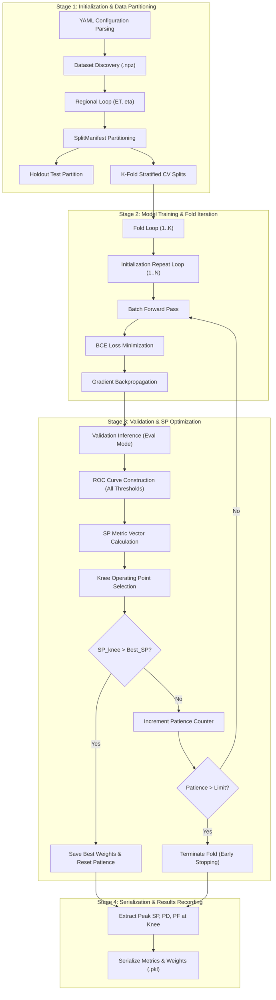
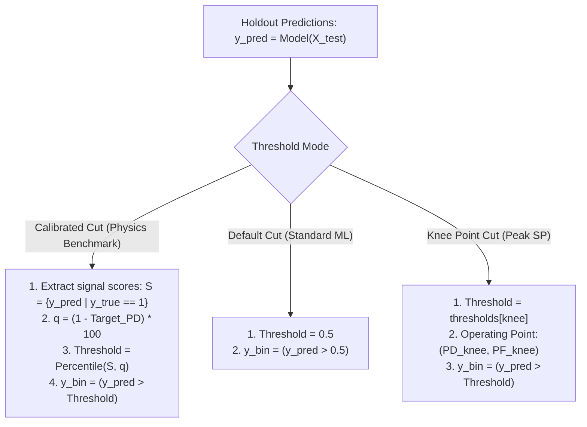

# Neural Ringer Training Pipeline, Operating Thresholds, and SP Early Stopping Process Specification

This document provides a formal process specification of the neural network training workflow, classification threshold calibration, and ATLAS SP (Sum Product) metric optimization engine in the `egamma_master` framework.

---

## 1. Process Overview & Execution Lifecycle

The training system optimizes multi-layer perceptron models on concentric calorimeter ring energy sums partitioned into kinematic regions defined by transverse energy ($E_T$) and pseudorapidity ($\eta$).



---

## 2. Stage 1: Data Partitioning and Regional Stratification

Training is orchestrated by [`NeuralRingerTrainer`](file:///home/pmourafr/egamma_master/src/core/Trainers/NeuralRingerTrainer.py) over the parameter grid formed by configured $E_T$ and $\eta$ bins:

### 2.1 Regional Segmentation

For each file in [`EgammaNpzDataset`](file:///home/pmourafr/egamma_master/src/core/Datasets/EgammaNpzDataset.py):

1. Bin indices $(i_{E_T}, i_\eta)$ are parsed via [`get_et_eta()`](file:///home/pmourafr/egamma_master/src/utils.py).
2. The region is filtered against `et_range_idx` and `eta_range_idx` in [`NeuralRingerTrainerConfiguration`](file:///home/pmourafr/egamma_master/src/Parser/NeuralRingerTrainerConfiguration.py).

### 2.2 Split Manifest Management

Data events within each region are partitioned deterministically through [`SplitManifest`](file:///home/pmourafr/egamma_master/src/core/Datasets/SplitManifest.py):

1. **Holdout Test Set ($S_{\text{test}}$)**: Reserved exclusively for post-training benchmarks and quadrant analysis.
2. **Cross-Validation Pool ($S_{\text{CV}}$)**: Divided into $K$ stratified folds (default $K = 10$) using `StratifiedKFold(n_splits=10, shuffle=True, random_state=42)`.
3. In each fold $k \in \{1, \dots, K\}$:
   - Training Set: $S_{\text{train}}^{(k)} = \bigcup_{j \ne k} S_{\text{CV}}^{(j)}$
   - Validation Set: $S_{\text{val}}^{(k)} = S_{\text{CV}}^{(k)}$

---

## 3. Stage 2: Training and Loss Optimization Process

Each fold execution is handled by [`FoldTrainer`](file:///home/pmourafr/egamma_master/src/core/Trainers/FoldTrainer.py) across mini-batches.


### 3.1 Continuous Probability Mapping vs. Hard Decision Thresholds

The neural network maps input calorimeter features $\mathbf{x}_i \in \mathbb{R}^D$ to an unconstrained scalar logit $z_i \in \mathbb{R}$, which is then transformed into a continuous probability prediction $\hat{y}_i \in (0, 1)$ via the Sigmoid activation:

$$z_i = \mathbf{w}^T \mathbf{x}_i + b, \qquad \hat{y}_i = \sigma(z_i) = \frac{1}{1 + e^{-z_i}}$$

#### The Non-Differentiability of Hard Step Classifiers

If a discrete decision threshold (e.g. $\tau = 0.5$) were applied during training to enforce hard binary labels:

$$\hat{c}_i = \begin{cases} 1 & \text{if } \hat{y}_i \ge \tau \\ 0 & \text{if } \hat{y}_i < \tau \end{cases}$$

the resulting classification is a Heaviside step function. Its derivative with respect to the pre-activation logit is zero almost everywhere:

$$\frac{\partial \hat{c}_i}{\partial z_i} = 0 \quad (\forall z_i \ne \sigma^{-1}(\tau))$$

By the chain rule, this would zero out the gradient for all model weights:

$$\frac{\partial \mathcal{L}}{\partial \mathbf{w}} = \sum_{i=1}^{B} \frac{\partial \mathcal{L}}{\partial \hat{c}_i} \cdot \underbrace{\frac{\partial \hat{c}_i}{\partial z_i}}_{0} \cdot \frac{\partial z_i}{\partial \mathbf{w}} = \mathbf{0}$$

Zero gradients prevent gradient descent from updating weights. Consequently, **hard classification cannot be applied during backpropagation**.

### 3.2 Gradient Mechanics of Binary Cross-Entropy ($\mathcal{L}_{\text{BCE}}$)

Instead of discrete decisions, optimization is guided by continuous distance estimation between predicted probabilities $\hat{y}_i \in (0, 1)$ and ground-truth targets $y_i \in \{0, 1\}$ (where $y_i = 1$ for signal photons and $y_i = 0$ for background jets):

$$\mathcal{L}_{\text{BCE}} = -\frac{1}{B} \sum_{i=1}^{B} \left[ y_i \ln(\hat{y}_i) + (1 - y_i) \ln(1 - \hat{y}_i) \right]$$

#### Analytical Error Gradient

Differentiating $\mathcal{L}_{\text{BCE}}$ with respect to the network logit $z_i$:

$$\frac{\partial \mathcal{L}_{\text{BCE}}}{\partial z_i} = \frac{\partial \mathcal{L}_{\text{BCE}}}{\partial \hat{y}_i} \cdot \frac{\partial \hat{y}_i}{\partial z_i} = \left[ -\frac{y_i}{\hat{y}_i} + \frac{1 - y_i}{1 - \hat{y}_i} \right] \cdot \left[ \hat{y}_i (1 - \hat{y}_i) \right] = \hat{y}_i - y_i$$

The error term $(\hat{y}_i - y_i)$ acts as a continuous, signed feedback vector indicating both the direction and magnitude of the prediction error:

- **Signal Event ($y_i = 1$)**:
  $$\frac{\partial \mathcal{L}}{\partial z_i} = \hat{y}_i - 1 < 0$$
  - If $\hat{y}_i = 0.05$ (severely misclassified), the gradient is $-0.95$, triggering a large positive weight update to push $z_i$ and $\hat{y}_i$ upward toward $1$.
  - If $\hat{y}_i = 0.98$ (correct and confident), the gradient is $-0.02$, resulting in near-zero weight perturbation.
- **Background Event ($y_i = 0$)**:
  $$\frac{\partial \mathcal{L}}{\partial z_i} = \hat{y}_i - 0 = \hat{y}_i > 0$$
  - If $\hat{y}_i = 0.90$ (severely misclassified), the gradient is $+0.90$, triggering a large negative weight update to push $z_i$ and $\hat{y}_i$ downward toward $0$.
  - If $\hat{y}_i = 0.02$ (correct and confident), the gradient is $+0.02$, maintaining model stability.

Through this formulation, the model receives precise continuous feedback on classification correctness without requiring hard decision thresholds.

### 3.3 Separation of Loss Optimization and `pred_target_limiar`

- **Optimization**: Driven entirely by the continuous loss gradient $(\hat{y}_i - y_i)$.
- **Diagnostic Logging**: The configuration parameter `pred_target_limiar` (default $0.5$) in [`NeuralRingerTrainerConfiguration`](file:///home/pmourafr/egamma_master/src/Parser/NeuralRingerTrainerConfiguration.py) is exclusively an arbitrary post-processing cutoff used in [`FoldTrainer._compute_batch_loss()`](file:///home/pmourafr/egamma_master/src/core/Trainers/FoldTrainer.py#L180-L181) to compute diagnostic accuracy:

$$\text{Accuracy}_{\text{epoch}} = \frac{1}{N} \sum_{i=1}^{N} \mathbb{I}\left( (\hat{y}_i \ge \tau_{\text{limiar}}) == y_i \right), \quad \tau_{\text{limiar}} = 0.5$$

This threshold is strictly informational; it does not participate in weight updates or early stopping decisions.

---

## 4. Stage 3: ATLAS SP Metric and ROC Knee Point Calculation

Validation and early stopping are governed by [`SPCallbackPyTorch`](file:///home/pmourafr/egamma_master/src/core/Callbacks/SPCallbackPyTorch.py). Rather than monitoring validation loss, the stopping criterion maximizes the ATLAS Sum Product (SP) performance index. All underlying inputs to the SP index are derived directly from scikit-learn's ROC curve routines.


### 4.1 Derivation from Scikit-Learn ROC Curves

At the end of each validation epoch, the accumulated continuous validation predictions $\mathbf{y}_{\text{pred}} \in [0, 1]$ and true labels $\mathbf{y}_{\text{true}} \in \{0, 1\}$ are processed through `sklearn.metrics.roc_curve`:

```python
false_positive_rate, true_positive_rates, thresholds = roc_curve(y_true, y_pred)
```

`roc_curve` automatically sweeps across the continuous probability range, sorting unique thresholds $\tau_j$ and evaluating empirical rates at each cutoff:

$$P_D(\tau_j) = \text{TPR}(\tau_j) = \frac{\sum_{i} \mathbb{I}(\hat{y}_i \ge \tau_j \land y_i = 1)}{\sum_{i} \mathbb{I}(y_i = 1)}$$

$$P_F(\tau_j) = \text{FPR}(\tau_j) = \frac{\sum_{i} \mathbb{I}(\hat{y}_i \ge \tau_j \land y_i = 0)}{\sum_{i} \mathbb{I}(y_i = 0)}$$

### 4.2 Mathematical Definition of the SP Index

Given Detection Probability ($P_D$) and False Alarm Probability ($P_F$), the background rejection is defined as:

$$R_{\text{bg}} = 1 - P_F = \text{TNR}$$

The normalized ATLAS SP metric is evaluated element-wise across the scikit-learn ROC arrays:

$$SP(\tau_j) = \sqrt{ \sqrt{P_D(\tau_j) \cdot (1 - P_F(\tau_j))} \cdot \left[ \frac{P_D(\tau_j) + (1 - P_F(\tau_j))}{2} \right] }$$

This metric represents the geometric mean between the geometric mean $\sqrt{P_D(1 - P_F)}$ and arithmetic mean $\frac{P_D + (1 - P_F)}{2}$ of signal efficiency and background rejection.

### 4.3 Algorithm: Epoch-End Knee Point Optimization

The callback identifies the specific threshold index where $SP$ reaches its peak (the "knee" operating point):

At the end of validation epoch $e$:

```
Algorithm 1: Epoch Validation and SP Knee Point Resolution
--------------------------------------------------------------------------------
Input: Validation targets y_true, Model predictions y_pred, Current epoch e
Output: stop_training (bool), callback_metrics (dict)


1: (FPR, TPR, thresholds) <- roc_curve(y_true, y_pred)
2: For each index j in 0 .. length(thresholds)-1 do:
3:     pd_j <- TPR[j]
4:     pf_j <- FPR[j]
5:     sp_j <- sqrt( sqrt(pd_j *(1 - pf_j))* 0.5 * (pd_j + (1 - pf_j)) )
6: End For
7: knee <- argmax(sp_values)
8: current_sp  <- sp_values[knee]
9: current_pd  <- TPR[knee]
10: current_pf <- FPR[knee]
11: current_th <- thresholds[knee]
12:
13: Record in callbackMetrics:
        max_sp_val.append(current_sp)
        max_sp_pd_val.append(current_pd)
        max_sp_fa_val.append(current_pf)
14:
15: If current_sp > best_sp Then:
16:     best_sp <- current_sp
17:     patience_counter <- 0
18:     best_weights <- copy(model.state_dict())
19:     best_pd_at_knee <- current_pd
20:     best_fa_at_knee <- current_pf
21:     best_epoch <- e
22: Else:
23:     patience_counter <- patience_counter + 1
24: End If
25:
26: If patience_counter > patience_limit Then:
27:     stop_training <- True
28: Else:
29:     stop_training <- False
30: End If
31: Return stop_training, callbackMetrics
--------------------------------------------------------------------------------

```

### 4.4 Sensitivity Derivatives

To analyze stability around the operating point, the partial derivatives $\frac{\partial (SP)}{\partial P_F}$ and $\frac{\partial (SP)}{\partial P_D}$ are evaluated at $(P_F^{\text{knee}}, P_D^{\text{knee}})$:

$$\frac{\partial (SP)}{\partial P_F} = c \cdot \frac{-\frac{P_D (P_D - P_F + 1)}{2 \sqrt{P_D(1 - P_F)}} - \sqrt{P_D(1 - P_F)}}{\sqrt{\sqrt{P_D(1 - P_F)} \cdot (P_D - P_F + 1)}}$$

$$\frac{\partial (SP)}{\partial P_D} = c \cdot \frac{\frac{(1 - P_F) (P_D - P_F + 1)}{2 \sqrt{P_D(1 - P_F)}} + \sqrt{P_D(1 - P_F)}}{\sqrt{\sqrt{P_D(1 - P_F)} \cdot (P_D - P_F + 1)}}$$

where $c = \frac{1}{2\sqrt{2}} \approx 0.353553$. These derivatives are logged per epoch to trace convergence characteristics.

---

## 5. Stage 4: Threshold Selection in Downstream Evaluation

Once training converges, model performance is evaluated under two distinct threshold regimes:



### 5.1 Calibrated Threshold Calibration (`threshold_mode="calibrated"`)

In ATLAS calorimeter trigger validation, models must match the signal efficiency of standard cut-based selections or benchmark targets (e.g. $P_D^{\text{target}} = 0.9424$):

1. **Signal Distribution Extraction**:
   $$S_{\text{sig}} = \{ \hat{y}_i \mid y_i = 1 \}$$
2. **Quantile Evaluation**:
   The decision threshold $\tau_{\text{calibrated}}$ is computed by taking the lower $(1 - P_D^{\text{target}})$ quantile of the signal score distribution:
   $$q = (1 - P_D^{\text{target}}) \times 100$$
   $$\tau_{\text{calibrated}} = \text{Quantile}(S_{\text{sig}}, q)$$
3. **Event Classification**:
   $$\hat{c}_i = \mathbb{I}(\hat{y}_i > \tau_{\text{calibrated}})$$
4. **False Alarm Probability Determination**:
   The resulting false alarm rate $P_F$ (background efficiency) is evaluated on the background sample:
   $$P_F = \frac{1}{|S_{\text{bg}}|} \sum_{j \in S_{\text{bg}}} \mathbb{I}(\hat{y}_j > \tau_{\text{calibrated}})$$

This operational mode is implemented in [`HoldoutEvaluator`](file:///home/pmourafr/egamma_master/src/core/Validation/HoldoutEvaluator.py#L209-L220) and [`QuadrantAnalyzer`](file:///home/pmourafr/egamma_master/src/core/Validation/QuadrantAnalyzer.py#L447-L455).

### 5.2 Default Thresholding (`threshold_mode="default"`)

Fixed decision boundary at the center of the sigmoid domain:

$$\hat{c}_i = \mathbb{I}(\hat{y}_i > 0.5)$$

Used for uncalibrated global accuracy and baseline verification.

### 5.3 Optimal Knee Thresholding

Operating point corresponding to the maximum SP score on the holdout or validation ROC:

$$\tau_{\text{knee}} = \text{thresholds}[\text{argmax}(SP)]$$

---

## 6. Metric Serialization and Persistence Summary

The parameters, operating points, and weights recorded during the training process are stored as follows:

| Process Variable | Originating Method / Attribute | Destination Field in Results | Storage Artifact |
| :--- | :--- | :--- | :--- |
| **Best Model Weights** | [`callback.get_best_model_weights()`](file:///home/pmourafr/egamma_master/src/core/Callbacks/SPCallbackPyTorch.py#L218-L224) | `best_weights` | `results/.../model_*.pkl` |
| **Peak SP Index** | [`callback.get_best_sp_value()`](file:///home/pmourafr/egamma_master/src/core/Callbacks/SPCallbackPyTorch.py#L226-L232) | `best_sp_value` | Fold metadata entry |
| **Detection Probability ($P_D$) at Knee** | [`callback.get_best_pd_at_knee()`](file:///home/pmourafr/egamma_master/src/core/Callbacks/SPCallbackPyTorch.py#L242-L248) | `best_pd_value` | Fold metadata entry |
| **False Alarm Rate ($P_F$) at Knee** | [`callback.get_best_fa_at_knee()`](file:///home/pmourafr/egamma_master/src/core/Callbacks/SPCallbackPyTorch.py#L234-L240) | `best_fa_value` | Fold metadata entry |
| **Epoch-by-Epoch Metric History** | `self.callbackMetrics` | `history["callbackMetrics"]` | `results/.../history_*.pkl` |
| **Best Epoch Index** | `self.__best_epoch` | `best_epoch` | Checkpoint log |
| **Cross-Validation Event Indices** | [`SplitManifest`](file:///home/pmourafr/egamma_master/src/core/Datasets/SplitManifest.py) | Manifest JSON dictionary | `results/.../split_manifest.json` |
